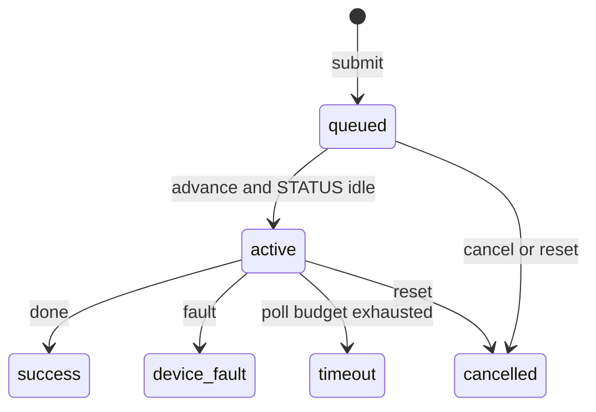

# Device command controller with simulated register bank

## Summary

Host-side C++20 controller for a command/status register bank. `Controller` checks that the bank is idle, submits one command, polls at most `poll_budget` times, and returns a typed outcome: `success`, `invalid_command`, `device_busy`, `device_fault`, or `timeout`. `reset` writes the reset register so the bank can accept another command.

The register bank in this repository is simulated.

## Features

- Idle check before submit. A zero command, a latched fault, a busy bank, or a completed command that has not been reset is rejected.
- Bounded polling. Timeout returns without clearing device state.
- Typed outcomes for success, invalid command, busy, fault, and timeout, plus an explicit reset path.
- `SimulatedDevice` register bank with a configurable completion delay and a one-shot fault.
- `SubmissionQueue` with owner-scoped tickets, waiting-only cancel, one active command, and fault/timeout blocking until reset.

## Design

### Outcomes

`Controller::execute` reads STATUS, then either returns or writes COMMAND.

| Condition | Outcome |
| --- | --- |
| command is 0 | `invalid_command` |
| STATUS fault | `device_fault` |
| STATUS busy or done | `device_busy` |
| done within the poll budget | `success` and RESULT |
| fault within the poll budget | `device_fault` |
| budget exhausted | `timeout` |

A timeout or fault leaves the register state in place. The caller decides when to `reset`.

```
idle --COMMAND--> busy --done--> done --RESET--> idle
                    |
                    +--fault--> fault --RESET--> idle
                    |
                    +--budget exhausted--> timeout outcome, registers unchanged
```

### Registers

| Offset | Name | Access | Meaning |
| --- | --- | --- | --- |
| `0x00` | COMMAND | write | Nonzero command identifier, accepted only when idle |
| `0x04` | STATUS | read | Bit 0 busy, bit 1 done, bit 2 fault |
| `0x08` | RESULT | read | Value produced when the command completes |
| `0x0c` | RESET | write | Write 1 to clear command, status, and result |

`SimulatedDevice` honors that map. While STATUS is busy, each STATUS read counts down a configured delay and then sets done or fault. A successful RESULT is `command * 2`, with unsigned wrap. `fail_next_command` arms fault for the next accepted command. Reads and writes of unsupported offsets throw.

### Submission queue

`SubmissionQueue` is a single-threaded scheduler over the same registers. Give it a positive waiting capacity and a per-command poll budget. The queue and `Controller` are separate clients of one bank; run only one of them against a given bank.

Capacity counts waiting jobs. One additional command may be active. `submit(owner, command)` returns a ticket, or an empty `std::optional` when the command is zero or the waiting queue is full. `inspect` and `cancel` require the submitting owner. `cancel` succeeds only while the job is waiting. An active command stays on the device.

`advance` starts the oldest waiting command only when STATUS is zero, then performs at most one completion poll. On success it reads RESULT and writes RESET before another command can start. On fault, or when the poll budget is exhausted, STATUS stays set and later jobs remain waiting.

`reset` writes RESET and marks the active job and every waiting job `cancelled`. Earlier terminal results, including success, fault, timeout, and prior cancellations, stay queryable by their owner for the life of the queue. `cancelled` on a job that was already active means the host dropped the result; the COMMAND write has already happened.



## Build & test

```sh
make test
make queue_tests
make demo
```

A C++20 compiler and `make` are enough. The default flags are `-std=c++20 -O2 -Wall -Wextra -Wpedantic -Werror`. `make test` runs the device suite and the queue suite. `make queue_tests` builds and runs the queue suite on its own. Checks evaluate their expressions even when `NDEBUG` is defined, so a submission inside a check still runs.

## Project layout

```
include/device.hpp    Registers, Controller, SimulatedDevice
include/queue.hpp     SubmissionQueue
src/device.cpp        controller and register bank
src/queue.cpp         submission queue
src/main.cpp          demo
tests/check.hpp       CHECK macro
tests/device_test.cpp controller cases
tests/queue_test.cpp  queue cases
Makefile
LICENSE
```

## Limitations

The controller and the queue are single-threaded. Fault and timeout block further commands until reset. Cancel applies to waiting tickets only, and reset does not reverse a command already written. Completion is polled; there is no interrupt or DMA path.
